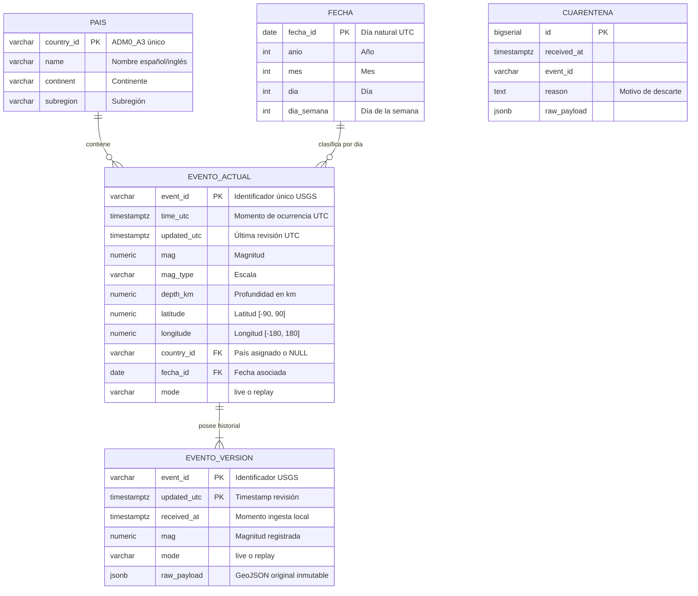

# Memoria del Proyecto: Observatorio de Actividad Sísmica

## 1. Objetivo y funcionamiento general
- **Pregunta que responde el observatorio:** ¿Dónde se está registrando actividad sísmica y cómo se compara con un periodo histórico equivalente?
- **Flujo de datos entre componentes:**
  `USGS -> Productor (Python) -> Kafka (Broker) -> Consumidor (Python) -> PostgreSQL -> FastAPI -> ngrok -> Netlify (Angular)`
- **Alcance:** Ámbito global / regional, filtros aplicados (ej. `minmagnitude=4`, tipo `earthquake`).

## 2. Diccionario de datos
| Campo | Significado | Tipo / Unidad | Tratamiento de ausencias |
|---|---|---|---|
| `event_id` | Identificador único del sismo | VARCHAR(50) | Obligatorio |
| `mag` | Magnitud | NUMERIC(4,2) | Se admite nulo (visualizado como ND) |
| `mag_type` | Tipo de escala de magnitud | VARCHAR(10) | Se conserva original |
| `depth_km` | Profundidad en kilómetros | NUMERIC(7,2) | Decimal, admite nulos según reglas |
| `latitude` | Latitud WGS84 | NUMERIC(9,6) | Obligatorio, rango [-90, 90] |
| `longitude` | Longitud WGS84 | NUMERIC(9,6) | Obligatorio, rango [-180, 180] |
| `time_utc` | Momento de ocurrencia | TIMESTAMPTZ | Obligatorio (convertido de Unix ms a UTC) |
| `updated_utc` | Momento de revisión en origen | TIMESTAMPTZ | Obligatorio para control de versiones |
| `country_id` | Código de país (ADM0_A3) | VARCHAR(10) | Nulo si no intersecta (sismo marítimo) |

## 3. Procedencia y registro de consultas

| Conjunto | Fuente Oficial | Periodo y Filtros | Procedimiento de Extracción y Persistencia |
|---|---|---|---|
| **Recientes (Streaming)** | Feed GeoJSON USGS (`all_day.geojson`) | Ventana móvil de las últimas 24 horas | Sondeo HTTP GET asíncrono cada 60 s. Filtrado en productor por `event_id` y `updated` con persistencia en SQLite. Publicación en topic `terremotos.live`. |
| **Histórico 2025** | API Catálogo USGS FDSNWS (`/fdsnws/event/1/query`) | Año 2025 completo, ámbito mundial, magnitud $\ge 4.0$, `eventtype=earthquake`, `orderby=time-asc` | Extracción particionada en 12 intervalos mensuales para evitar superar el umbral de 20.000 registros de la API. Archivos almacenados en `datos/historico/` para descargas reproducibles e insertados con `mode='historical'`. |
| **Catálogo Geográfico** | Natural Earth (`1:110m Cultural Vectors`) | 177 entidades soberanas mundiales (`paises.geojson`) | Integración geoespacial con `shapely.STRtree`. Asignación de código `ADM0_A3` y nombre. Terremotos marítimos clasificados como `Sin país asignado` (`NULL`). |

### 3.1. Registro de Consultas Históricas
- Plantilla de consulta mensual:
  `https://earthquake.usgs.gov/fdsnws/event/1/query?format=geojson&starttime={YYYY-MM-01T00:00:00Z}&endtime={YYYY-MM-01T00:00:00Z}&minmagnitude=4&eventtype=earthquake&orderby=time-asc`
- Deduplicación de fronteras temporales mediante clave primaria `(event_id, updated_utc)` en `evento_version`.
- Registro de metadatos y trazabilidad guardado en `datos/historico/registro_extraccion_2025.json`.

## 4. Calidad del dato y Tratamiento en Streaming

### 4.1. Reglas de Validación y Cuarentena
El consumidor Python valida cada mensaje recibido de Kafka antes de persistirlo:
1. **Tipo de evento:** Filtra exclusivamente eventos con `properties.type == 'earthquake'`. Cualquier otro evento (explosiones, canteras, colapsos) se desvía a la tabla `cuarentena` con el motivo `"Tipo no sísmico excluido del análisis"`.
2. **Coordenadas:** Valida que existan al menos 2 coordenadas y que se encuentren estrictamente en los rangos geográficos válidos (longitud $[-180, 180]$, latitud $[-90, 90]$). Las anomalías se registran en `cuarentena` sin detener el consumo.
3. **Timestamps:** Comprueba que `time` y `updated` sean valores numéricos válidos en milisegundos Unix y los transforma a `TIMESTAMPTZ` en UTC.
4. **Valores nulos:** Los nulos en `mag` o `depth` se admiten conforme al estándar de USGS y se conservan como `NULL` (mostrados en el panel como `ND` y excluidos de medias aritméticas para no sesgar las estadísticas).

### 4.2. Mecanismo de Idempotencia y Secuencia de Commit
Para garantizar semántica *at-least-once* sin duplicación ni corrupción de estado:
1. **Doble persistencia de estado:** El productor utiliza SQLite + RAM para no reenviar versiones ya emitidas.
2. **Historial inmutable:** Cada versión recibida se inserta en `evento_version` con restricción de unicidad compuesta `PRIMARY KEY (event_id, updated_utc)`.
3. **Upsert condicional en `evento_actual`:**
   ```sql
   INSERT INTO evento_actual (...) VALUES (...)
   ON CONFLICT (event_id) DO UPDATE SET ...
   WHERE EXCLUDED.updated_utc > evento_actual.updated_utc;
   ```
   - Si se reenvía la misma versión: el `WHERE` evita cualquier modificación.
   - Si llega una versión posterior: se actualiza el estado vigente.
   - Si llega tarde una versión antigua: el `WHERE` protege el estado actual impidiendo que sea degradado.
4. **Confirmación de Offset (Manual Commit):**
   El consumidor desactiva `enable_auto_commit`. El `commit` del offset en Kafka se ejecuta **exclusivamente tras el `commit()` exitoso de la transacción en PostgreSQL**. Si la base de datos falla, se efectúa un `rollback()` y Kafka vuelve a entregar el mensaje tras la recuperación.

## 5. Modelo conceptual, lógico y físico

### 5.1. Modelo Conceptual
El sistema modela el fenómeno de la actividad sísmica distinguiendo la identidad intrínseca de un terremoto de las sucesivas revisiones que publica la fuente (USGS).
- **Evento Sísmico:** Entidad principal que representa un terremoto ocurrido en un instante y lugar físico.
- **Versión de Evento:** Cada una de las actualizaciones o revisiones emitidas por los sismólogos de USGS.
- **País / Región Geográfica:** Entidad territorial del catálogo Natural Earth 1:110m delimitada por polígonos. Un terremoto puede pertenecer a un país o carecer de él (sismo en aguas internacionales).
- **Fecha:** Dimensión temporal (día natural UTC) para agregaciones y análisis.
- **Cuarentena:** Almacén de aislamiento para registros malformados, valores no numéricos o coordenadas fuera de rango.



### 5.2. Modelo Lógico
- **`pais`**: `(country_id [PK], name, continent, subregion)`.
- **`fecha`**: `(fecha_id [PK], anio, mes, dia, dia_semana, nombre_mes, nombre_dia)`.
- **`evento_actual`**: `(event_id [PK], time_utc, updated_utc, mag, mag_type, depth_km, latitude, longitude, place, country_id [FK pais], fecha_id [FK fecha], mode, raw_properties, created_at, last_modified_at)`.
- **`evento_version`**: `(event_id, updated_utc [PK compuesta], received_at, mag, mag_type, depth_km, latitude, longitude, mode, raw_payload)`.
- **`cuarentena`**: `(id [PK], received_at, event_id, raw_payload, reason)`.

### 5.3. Modelo Físico y Justificación de Índices
Implementado en PostgreSQL 16 con el script [sql/init.sql](file:///c:/Users/marqu/Desktop/IABD/BD/observatorio-sismico-materiales/observatorio-sismico/sql/init.sql).

| Índice | Tabla y Columnas | Operación que optimiza | Justificación técnica |
|---|---|---|---|
| `idx_evento_actual_time` | `evento_actual(time_utc DESC)` | `WHERE time_utc >= ... AND time_utc < ... ORDER BY time_utc DESC` | La API filtra por defecto las últimas 24h y rangos temporales. El índice B-Tree evita un escaneo secuencial (*Seq Scan*) completo y acelera la paginación. |
| `idx_evento_actual_mag` | `evento_actual(mag)` | `WHERE mag >= min_mag` | Los filtros comunes en sismología descartan microterremotos (`mag >= 4.0`). El índice permite un *Index Scan* selectivo reduciendo lecturas de disco. |
| `idx_evento_actual_country` | `evento_actual(country_id)` | `WHERE country_id = ?` y `GROUP BY country_id` | Acelera las consultas por país desde el selector del panel y la agregación geográfica de estadísticas sin necesidad de recorrer eventos no vinculados. |
| `idx_evento_actual_mode` | `evento_actual(mode)` | `WHERE mode = 'live'` / `'replay'` | Aísla completamente los datos de demostración histórica acelerada (*replay*) de los datos reales en streaming (*live*). |
| `idx_evento_version_received` | `evento_version(received_at DESC)` | `ORDER BY received_at DESC` | Facilita la auditoría operativa y la verificación de ingesta reciente. |

### 5.4. Capa de Servicios: Contrato de la API FastAPI
La API implementa los endpoints requeridos por el frontend conforme a `CONTRATO-API.md`:
- **`GET /api/salud`:** Estado de conexión a PostgreSQL, fecha de última ingesta exitosa y cálculo de segundos transcurridos para alertar de productores inactivos.
- **`GET /api/eventos`:** Retorna un GeoJSON `FeatureCollection` con coordenadas `[lon, lat, depth]` y propiedades enriquecidas (`country_id`, `country_name`). Admite filtros por `start`, `end`, `min_mag`, `country_id` y `mode` (`live` o `replay`), con soporte de paginación/truncado.
- **`GET /api/estadisticas`:** Calcula agregaciones por ventana fija de 1 hora UTC, recuentos por país, histogramas de magnitud y profundidad, y la comparativa histórica equivalente (media diaria 2025 vs últimas 24h bajo los mismos filtros).
- **`GET /api/paises`:** Catálogo de países ordenados alfabéticamente para poblar los filtros de la interfaz.
- **Seguridad y CORS:** Configurado para responder a peticiones preflight `OPTIONS` y autorizar peticiones desde el host local (`localhost:4200`) y cualquier dominio de despliegue en Netlify (`https://*.netlify.app`), admitiendo la cabecera `ngrok-skip-browser-warning`.

### 5.5. Interfaz de Usuario y Accesibilidad (Angular + Leaflet)
- **Filtros interactivos:** Modo operativo (`live` / `replay`), ámbito geográfico con los 177 países, umbral mínimo de magnitud y rango de fechas UTC.
- **Gráficos estadísticos y ventanas:** Visualizaciones de distribución por magnitud, profundidad, histograma de actividad por ventanas fijas de 1 hora UTC y tarjeta de comparativa histórica con el año 2025.
- **Tabla accesible:** Alternativa visual semántica completa (WCAG AA) que permite explorar fecha, magnitud, profundidad, ubicación y coordenadas sin depender exclusivamente del color ni de la visión espacial del mapa.
- **Transparencia operativa:** Banners explícitos para alertar de la pérdida de conexión con la API, indicar el modo de reproducción acelerada y avisar si el productor de ingesta está detenido (más de 3 minutos sin novedades).

## 6. Análisis y conclusiones
- Conclusión 1:
- Conclusión 2:
- Conclusión 3:

## 7. Complejidad, rendimiento y costes
- Análisis de complejidad algorítmica ($O(1)$ vs $O(N)$).
- Mediciones empíricas de tiempo y memoria con 3 tamaños de datos.
- Estimación de costes de infraestructura.
- Propuestas de mejora y escalabilidad.

## 8. Evidencias de pruebas de aceptación
- Pruebas de idempotencia, revisiones, cuarentena, caída de servicios y modo reproducción.

## 9. Reproducción Histórica Acelerada (Replay)
- **Objetivo:** Demostrar el funcionamiento completo del pipeline de streaming durante la defensa sin depender de la ocurrencia de nuevos terremotos en tiempo real.
- **Implementación:** Script [backend/scripts/replay.py](file:///c:/Users/marqu/Desktop/IABD/BD/observatorio-sismico-materiales/observatorio-sismico/backend/scripts/replay.py).
- **Aislamiento de datos:** Emite mensajes al topic `terremotos.replay` con el atributo `mode='replay'`. El consumidor procesa y etiqueta estos registros de forma segregada en PostgreSQL.
- **Velocidad y cadencia:** Parámetro `--delay` (por defecto 1.5 s entre eventos).
- **Casos de prueba inyectados:**
  1. Terremoto inicial `demo-q12-E1` (magnitud 4.2).
  2. Repetición idéntica de `demo-q12-E1` (demuestra que no suma filas ni eventos).
  3. Revisión posterior de `demo-q12-E1` con magnitud 4.6 (demuestra que actualiza `evento_actual` y crea una nueva fila en `evento_version`).
  4. Versión atrasada de `demo-q12-E1` con magnitud 4.2 (demuestra que no degrada el registro actual más moderno).
  5. Nuevo terremoto `demo-q12-E2` (magnitud 3.1).
  6. Caso anómalo `demo-q12-E3-ANOMALIA` (coordenadas imposibles lon=999, lat=999 $\rightarrow$ demuestra el desvío automático a `cuarentena`).
- **Visualización en el panel:** La interfaz indica explícitamente «MODO REPRODUCCIÓN» para evitar confusiones con la actividad real.

## 10. Despliegue en Netlify y Túnel Seguro ngrok
- **Arquitectura de publicación:**
  - El frontend estático (SPA Angular) se compila en `dist/observatorio/browser` y se aloja en Netlify con certificado TLS gestionado.
  - La API FastAPI se ejecuta en local dentro del contenedor Docker escuchando en `0.0.0.0:8000`.
  - El agente ngrok establece un túnel cifrado hacia el exterior, exponiendo una URL HTTPS pública (ej. `https://xxx.ngrok-free.app`).
  - El navegador del cliente consulta la API exclusivamente mediante HTTPS a través de ngrok, satisfaciendo la política de contenido mixto (*mixed content*) del navegador.
- **Comprobación de Caída y Resiliencia del Túnel:**
  - Al interrumpir el túnel ngrok, el panel de Netlify intercepta el error de red sin fallar.
  - Se activa el banner de advertencia `⚠️ Desconexión de API / Túnel`, manteniendo en pantalla la última capa válida de eventos y estadísticas.
  - Al restaurar ngrok, el frontend recupera automáticamente la sincronización en el siguiente ciclo o al pulsar "Aplicar Filtros".
