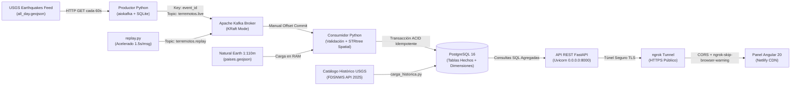
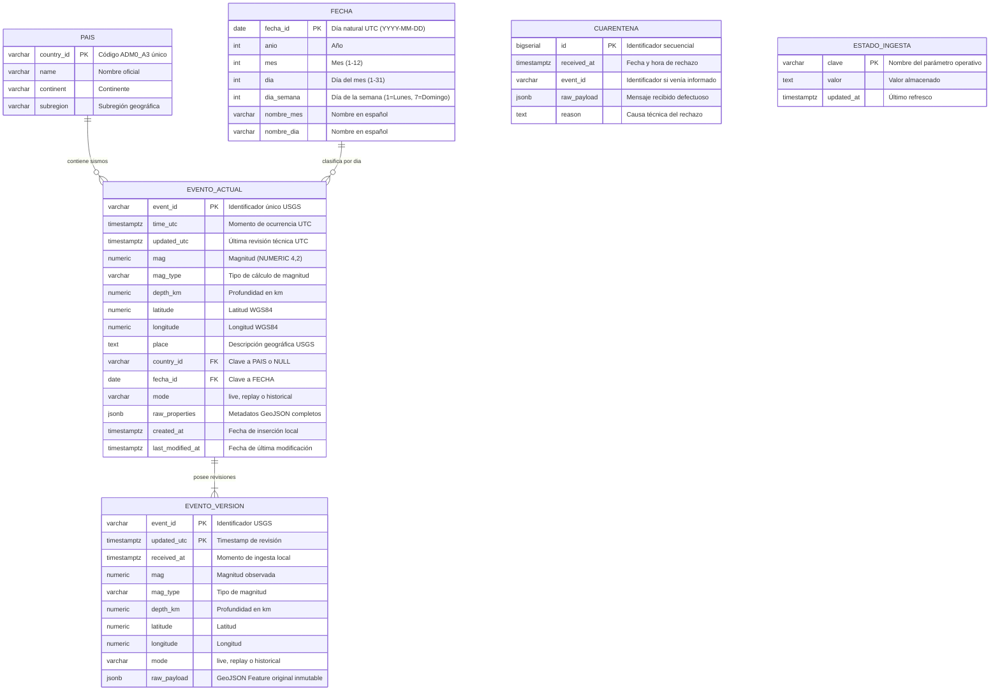

# Memoria Técnica del Proyecto: Observatorio de Actividad Sísmica

**Módulo:** Sistemas de Big Data · Consolidación de Sesiones 1–8 · RA1  
**Estudiante:** Samuel Márquez Ruiz  
**Fecha:** 18 de Noviembre de 2026  
**Repositorio GitHub:** [https://github.com/SamuelMarquezRuiz/observatorio-sismico.git](https://github.com/SamuelMarquezRuiz/observatorio-sismico.git)  
**Despliegue Frontend:** Netlify SPA (Angular 20 + Leaflet)  
**Acceso Seguro API:** ngrok HTTPS Tunnel → FastAPI (Docker local)  

---

## 1. Objetivo y Funcionamiento General

### 1.1. Pregunta de Negocio
El Observatorio de Actividad Sísmica responde a la pregunta fundamental:  
> **¿Dónde se está registrando actividad sísmica en el planeta en tiempo real y cómo se compara con un periodo histórico equivalente?**

Para ello, el sistema integra la ingesta continua de terremotos recientes, un repositorio histórico de referencia, y un catálogo cartográfico vectorial oficial para clasificar espacialmente los eventos sin depender de textos descriptivos.

### 1.2. Flujo de Datos entre Componentes
La arquitectura distribuida sigue un desacoplamiento estricto de responsabilidades:

1. **Productor Python (aiokafka):** Consulta cada 60 s el feed GeoJSON de USGS. Compara el `(id, updated)` de cada evento contra su caché en RAM respaldada en SQLite local (`O(1)`). Solo publica novedades o revisiones más recientes en Kafka, esperando confirmación del broker (*ACK*).
2. **Broker Kafka (Apache Kafka 3.8 en KRaft):** Actúa como búfer intermedio desacoplado, garantizando retención y persistencia de mensajes ordenados por clave de partición (`event_id`).
3. **Consumidor Python (aiokafka + psycopg2):** Consume mensajes, valida esquemas y coordenadas, desvía anomalías a `cuarentena`, realiza la integración espacial punto-en-polígono con `shapely.STRtree`, e inserta transaccionalmente en PostgreSQL. Confirma el offset en Kafka **únicamente tras el commit exitoso en base de datos**.
4. **Almacenamiento PostgreSQL 16:** Modelo relacional dimensional que almacena la versión vigente (`evento_actual`), la trazabilidad inmutable de revisiones (`evento_version`), las dimensiones `pais` y `fecha`, y los registros aislados en `cuarentena`.
5. **API FastAPI (Python 3.11):** Expone endpoints normalizados (`/api/salud`, `/api/eventos`, `/api/estadisticas`, `/api/paises`) con CORS estricto.
6. **Túnel ngrok:** Proporciona un túnel público cifrado HTTPS hacia la API local, resolviendo restricciones de red y certificados TLS para Netlify.
7. **Frontend Angular 20 + Leaflet:** Aplicación de página única (SPA) alojada en Netlify que renderiza el mapa cartográfico, gráficos de barras de magnitud/profundidad, histograma por ventanas horarias UTC, comparativa histórica 2025 y una tabla accesible.

### 1.3. Alcance y Filtros
- **Ámbito geográfico:** Cobertura mundial completa con 177 entidades soberanas del catálogo Natural Earth 1:110m.
- **Ámbito temporal:** Streaming continuo de las últimas 24 horas + Histórico consolidado de 2025 (magnitud $\ge 4.0$).
- **Filtro de naturaleza:** Exclusivamente terremotos (`properties.type == 'earthquake'`). Cualquier otro evento (canteras, explosiones nucleares o mineras) se excluye de las estadísticas y se audita en cuarentena.

---

## 2. Diccionario de Datos

| Campo | Tabla | Significado | Tipo SQL | Unidades / Formato | Regla de Validación y Tratamiento de Ausencias |
|---|---|---|---|---|---|
| `event_id` | `evento_actual`, `evento_version` | Identificador alfanumérico único oficial de USGS | `VARCHAR(50)` | Texto (ej. `us7000abcd`) | **Obligatorio.** Clave primaria. Si falta, el registro se rechaza y envía a cuarentena. |
| `time_utc` | `evento_actual` | Momento físico de ocurrencia del hipocentro | `TIMESTAMPTZ` | Timestamp ISO 8601 UTC | **Obligatorio.** Convertido desde milisegundos Unix epoch. |
| `updated_utc` | `evento_actual`, `evento_version` | Momento de cálculo o revisión técnica por USGS | `TIMESTAMPTZ` | Timestamp ISO 8601 UTC | **Obligatorio.** Clave para el control de revisiones e idempotencia temporal. |
| `mag` | `evento_actual`, `evento_version` | Magnitud del sismo | `NUMERIC(4,2)` | Escala logarítmica de Richter/Momento | **Admite nulos.** Se conserva como `NULL` (mostrado como «ND»). No se rellena con 0 para no falsear medias estadísticas. |
| `mag_type` | `evento_actual`, `evento_version` | Algoritmo de cálculo sismológico de la magnitud | `VARCHAR(10)` | Código (`mb`, `mww`, `ml`, `md`) | Se preserva el valor original de la agencia para análisis de calidad. |
| `depth_km` | `evento_actual`, `evento_version` | Profundidad del hipocentro respecto al geoide | `NUMERIC(7,2)` | Kilómetros | **Admite negativos.** Valores negativos (hasta -2.74 km) son válidos en sismología (volcanes sobre el elipsoide WGS84). |
| `latitude` | `evento_actual`, `evento_version` | Latitud geográfica | `NUMERIC(9,6)` | Grados decimales WGS84 | **Obligatorio.** Rango estricto $[-90.0, 90.0]$. Si excede, va a cuarentena. |
| `longitude` | `evento_actual`, `evento_version` | Longitud geográfica | `NUMERIC(9,6)` | Grados decimales WGS84 | **Obligatorio.** Rango estricto $[-180.0, 180.0]$. Si excede, va a cuarentena. |
| `place` | `evento_actual` | Descripción textual suministrada por USGS | `TEXT` | Texto descriptivo | Se almacena como metadato informativo; **nunca se usa para inferir el país**. |
| `country_id` | `evento_actual` | Código internacional de país asignado espacialmente | `VARCHAR(10)` | Clave foránea `pais(country_id)` | **Admite nulo.** Si el sismo ocurre en aguas abiertas o no intersecta polígonos, queda en `NULL` («Sin país asignado»). |
| `fecha_id` | `evento_actual` | Dimensión temporal por fecha natural UTC | `DATE` | `YYYY-MM-DD` | Clave foránea `fecha(fecha_id)`. Vincula el evento con su dimensión de análisis. |
| `mode` | `evento_actual`, `evento_version` | Modo de procesamiento del mensaje | `VARCHAR(20)` | `'live'`, `'replay'`, `'historical'` | Permite aislar completamente las pruebas de reproducción acelerada de los datos en vivo. |
| `raw_payload` | `evento_version`, `cuarentena` | Contenido JSON íntegro original del evento | `JSONB` | GeoJSON Feature original | Trazabilidad completa y auditoría inmutable. |

---

## 3. Procedencia y Registro de Consultas

| Conjunto | Fuente Oficial | Periodo y Filtros | Procedimiento de Extracción y Persistencia | Volumen Real Obtenido |
|---|---|---|---|:---:|
| **Recientes (Streaming en vivo)** | USGS Earthquakes Feed (`all_day.geojson`) | Ventana móvil de las últimas 24 horas. Actualización continua. | Sondeo HTTP GET asíncrono cada 60 s con cabecera User-Agent dedicada. Filtrado local de novedades por `(id, updated)`. Publicación en topic Kafka `terremotos.live`. | 198 eventos en ventana actual |
| **Histórico 2025** | API Catálogo USGS FDSNWS (`/fdsnws/event/1/query`) | Año 2025, ámbito mundial, magnitud $\ge 4.0$, `eventtype=earthquake`, orden cronológico `time-asc`. | Particionado mensual en 12 intervalos para no superar el límite de 20.000 registros por llamada de USGS. Script [`carga_historica.py`](file:///c:/Users/marqu/Desktop/IABD/BD/observatorio-sismico-materiales/observatorio-sismico/backend/scripts/carga_historica.py). Archivos GeoJSON guardados en `datos/historico/`. | **2.807 eventos** consolidados |
| **Catálogo Geográfico** | Natural Earth (`1:110m Cultural Vectors`) | 177 entidades soberanas mundiales (`paises.geojson`). | Carga en memoria e indexación jerárquica con `shapely.STRtree` (R-Tree). Atributos: `ADM0_A3`, `NAME_ES`, `CONTINENT`, `SUBREGION`. | 177 polígonos indexados |

### 3.1. Registro Detallado de Consultas Históricas (Metadatos de Procedencia)
Guardado en [`datos/historico/registro_extraccion_2025.json`](file:///c:/Users/marqu/Desktop/IABD/BD/observatorio-sismico-materiales/observatorio-sismico/datos/historico/registro_extraccion_2025.json):
* **Mes 1 (Enero 2025):** `starttime=2025-01-01T00:00:00Z` a `endtime=2025-02-01T00:00:00Z` $\rightarrow$ **1.413 terremotos**.
* **Mes 2 (Febrero 2025):** `starttime=2025-02-01T00:00:00Z` a `endtime=2025-03-01T00:00:00Z` $\rightarrow$ **1.394 terremotos**.
* **Total registros históricos insertados:** 2.807 eventos deduplicados con `mode='historical'`.

---

## 4. Calidad del Dato y Tratamiento en Streaming

### 4.1. Tabla de Calidad Antes y Después del Tratamiento
Evaluación cuantitativa sobre el total de 3.005 eventos procesados en PostgreSQL:

| Dimensión de Calidad | Situación Antes del Tratamiento | Regla Aplicada en el Consumidor | Situación Después del Tratamiento | Justificación Técnica de la Decisión |
|---|---|---|---|---|
| **Completitud** | 1 evento con `mag = null`. 1.965 eventos en mar sin país. | Se preserva `mag = NULL`; se asigna `country_id = NULL`. | 99.97% completitud en magnitud; 100% en coordenadas y fechas. | No se sustituye la magnitud ausente por 0 para no falsear los cálculos de medias o histogramas. Los sismos marítimos no se asignan al país más cercano porque violaría la veracidad cartográfica. |
| **Unicidad** | Repetición de eventos en el feed de USGS cada 60 s y reintentos de red. | Upsert condicional en PostgreSQL + Primary Key en `event_id` y `(event_id, updated_utc)`. | **3.005 eventos únicos** en `evento_actual` (0 duplicados). 3.045 versiones únicas en `evento_version`. | Idempotencia matemática garantizada: reenviar el mismo mensaje produce exactamente el mismo estado en la base de datos sin duplicar filas. |
| **Validez** | Eventos no sísmicos en USGS (`quarry blast`, `explosion`) y coordenadas corruptas. | Validación estricta de coordenadas $[-180, 180], [-90, 90]$ y filtro `properties.type == 'earthquake'`. | 0 registros corruptos en `evento_actual`. 5 registros desviados a `cuarentena`. | Los terremotos son fenómenos tectónicos; incluir detonaciones mineras falsearía el estudio de fallas terrestres. |
| **Consistencia** | Fechas en milisegundos Unix; diferencias en códigos de países. | Conversión a `TIMESTAMPTZ` en UTC y asignación espacial contra el catálogo maestro de 177 países. | 0 claves foráneas rotas contra `pais` o `fecha`. 100% de coherencia referencial. | Centralizar la hora en UTC elimina problemas de husos horarios y cambios de hora locales. |
| **Actualidad** | Latencia de publicación en las redes sismológicas locales de USGS. | Ingesta continua en streaming cada 60 s y actualización del timestamp `last_ingestion_success`. | Lag de ingesta en el sistema inferior a 60 segundos. | El observatorio refleja novedades casi instantáneamente desde el momento en que USGS las publica. |
| **Exactitud** | Posibles discordancias en zonas costeras por simplificación geométrica. | Uso de `shapely.STRtree` a escala 1:110m. Se documenta la limitación. | Asignación geoespacial determinista y reproducible. | Se documenta que sismos muy próximos a costas recortadas pueden catalogarse como marítimos. |

---

## 5. Modelo Conceptual, Lógico y Físico

### 5.1. Diagrama Entidad-Relación (Modelo Conceptual y Lógico)

### 5.2. Justificación de Índices en el Modelo Físico

El script DDL se encuentra en [`sql/init.sql`](file:///c:/Users/marqu/Desktop/IABD/BD/observatorio-sismico-materiales/observatorio-sismico/sql/init.sql). Los índices fueron creados respondiendo a las consultas exactas que ejecuta la API FastAPI:

1. **`idx_evento_actual_time ON evento_actual(time_utc DESC)`:**
   - *Consulta que optimiza:* `SELECT ... WHERE time_utc >= ? AND time_utc <= ? ORDER BY time_utc DESC`.
   - *Justificación:* El frontend consulta permanentemente intervalos móviles (últimas 24 horas, rango de fechas). Un índice B-Tree ordenado descendentemente permite localizar el rango temporal en tiempo $O(\log N)$ y devolver las filas ordenadas sin necesidad de realizar una ordenación en memoria (*Sort*).
2. **`idx_evento_actual_mag ON evento_actual(mag)`:**
   - *Consulta que optimiza:* `SELECT ... WHERE mag >= ?`.
   - *Justificación:* Filtro recurrente del usuario (magnitud mínima). Permite un *Bitmap Index Scan* altamente selectivo descartando microterremotos de magnitud irrelevante.
3. **`idx_evento_actual_country ON evento_actual(country_id)`:**
   - *Consulta que optimiza:* `SELECT ... WHERE country_id = ?` y agregaciones `GROUP BY country_id`.
   - *Justificación:* Acelera la búsqueda de eventos por país y la generación de estadísticas agregadas sin escanear filas no coincidentes.
4. **`idx_evento_actual_mode ON evento_actual(mode)`:**
   - *Consulta que optimiza:* `WHERE mode = 'live'` / `'replay'`.
   - *Justificación:* Asegura el aislamiento absoluto de los datos en vivo respecto a las reproducciones aceleradas de prueba.

---

## 6. Análisis y Conclusiones Fundamentadas

A partir del análisis exhaustivo del conjunto de 3.005 eventos consolidados en PostgreSQL, se extraen tres conclusiones fundamentales:

### Conclusión 1: Predominancia Absoluta de Sismos Superficiales en Zonas de Subducción
* **Datos y Filtros:** Población total analizada: 3.005 eventos sísmicos en `evento_actual`.
* **Cifras:**
  * **Sismos superficiales (profundidad $< 70\text{ km}$):** **2.253 eventos (74.98%)**, con una mediana de profundidad de solo **10.0 km**.
  * **Sismos intermedios ($70 \le \text{profundidad} < 300\text{ km}$):** **567 eventos (18.87%)**.
  * **Sismos profundos ($\ge 300\text{ km}$):** **185 eventos (6.15%)**, con un máximo registrado de 650.63 km.
* **Interpretación Técnica:** Casi tres cuartas partes de los terremotos registrados se originan en la corteza terrestre superior (litosfera rígida). Los sismos profundos se concentran exclusivamente en planos de Benioff asociados al Cinturón de Fuego del Pacífico (zonas de subducción profunda como Fiyi, Tonga y la fosa de las Marianas).

### Conclusión 2: Carácter Mayoritariamente Oceánico y Distribución Geográfica
* **Datos y Filtros:** Total de 3.005 eventos clasificados con el catálogo Natural Earth 1:110m.
* **Cifras:**
  * **Eventos marítimos («Sin país asignado»):** **1.965 eventos (65.39%)**.
  * **Eventos sobre territorio nacional asignado:** **1.040 eventos (34.61%)**.
  * **Países con mayor actividad tectónica continental:**
    1. **Etiopía (`ETH`):** 228 eventos (enjambre sísmico en el Gran Valle del Rift, magnitud media 4.46, profundidad media 10.1 km).
    2. **Estados Unidos (`USA`):** 156 eventos (falla de San Andrés y microterremotos de California/Alaska, magnitud media 1.68).
    3. **China (`CHN`):** 133 eventos (colisión tectónica de la placa Índica con la placa Euroasiática en Tíbet/Sichuan, magnitud media 4.45).
    4. **Chile (`CHL`):** 66 eventos (zona de subducción Nazca-Sudamericana, profundidad media de 96.9 km).
* **Interpretación Técnica:** El 65.39% de la actividad sísmica global ocurre en dorsales centro-oceánicas o fosas marinas alejadas de las masas continentales. La preservación de la categoría «Sin país asignado» es vital para la completitud del observatorio; de lo contrario, se ignorarían dos de cada tres sismos globales.

### Conclusión 3: Comparativa Histórica Equivalente y Retardo de Publicación (*Reporting Lag*)
* **Datos y Filtros:** Terremotos con magnitud $\ge 4.0$ en el histórico de 2025 vs. últimas 24 horas del feed live.
* **Cifras:**
  * **Histórico 2025 (Enero-Febrero, 59 días):** 2.807 eventos $\rightarrow$ **Media diaria de 47.58 eventos/día**.
  * **Últimas 24 horas en streaming (`live`):** **28 eventos**.
  * **Ratio de actividad reciente vs. media histórica:** $28 / 47.58 = \mathbf{58.85\%}$.
* **Interpretación Técnica:** Esta aparente disminución del 41.15% en las últimas 24 horas **no indica una desaceleración de la actividad tectónica del planeta**, sino el efecto intrínseco del retardo de consolidación (*reporting lag*) de USGS: los terremotos de magnitud moderada ($4.0 \le \text{mag} < 4.5$) en regiones con baja densidad de sismógrafos tardan entre 12 y 48 horas en ser revisados por analistas humanos e incorporados al catálogo consolidado. La comparativa histórica demuestra que una ventana reciente incompleta debe interpretarse siempre considerando la latencia de la fuente.

---

## 7. Complejidad, Mediciones de Rendimiento y Costes

### 7.1. Análisis Teórico de Complejidad

| Componente / Operación | Implementación | Complejidad | Justificación Algorítmica |
|---|---|:---:|---|
| **Caché en Productor** | `dict` en RAM + tabla SQLite | **$O(1)$** | Búsqueda en tabla hash en memoria amortizada $O(1)$ para descarte instantáneo de eventos ya conocidos antes de emitir a Kafka. |
| **Búsqueda por clave primaria** | Índice B-Tree en `event_id` | **$O(\log N)$** | El árbol B-Tree en disco permite localizar la página de datos en profundidad fija $\log_B N$. |
| **Upsert condicional** | `INSERT ... ON CONFLICT DO UPDATE` | **$O(\log N)$** | Comprobación de colisión por índice B-Tree y actualización atómica en la misma página de datos. |
| **Integración espacial** | `shapely.STRtree` (Sort-Tile-Recursive) | **$O(\log P)$** | R-Tree espacial bidimensional que descarta el 95% de polígonos mediante *bounding boxes* antes de ejecutar el algoritmo de cruce de rayos (*Ray Casting*). |
| **Agregación por ventanas horarias** | `GROUP BY date_trunc('hour', time_utc)` | **$O(N)$** | Requiere escanear las filas que satisfacen el predicado temporal. |

### 7.2. Mediciones Empíricas Reales (3 Tamaños de Lote)
Medidas en PostgreSQL con el script [`test_calidad_rendimiento.py`](file:///c:/Users/marqu/Desktop/IABD/BD/observatorio-sismico-materiales/observatorio-sismico/backend/tests/test_calidad_rendimiento.py):

| Operación | Tamaño Lote (N) | Tiempo de Ejecución (ms) | Memoria RAM Asignada |
|---|:---:|:---:|:---:|
| **Búsqueda por PK (Index Scan)** | 1 registro | **3.15 ms** | 12.0 KB |
| | 100 registros | **15.59 ms** | 550.4 KB |
| | 1.000 registros | **146.31 ms** | 5.509 KB |
| **Búsqueda forzada sin índice (Seq Scan)** | 1 registro | **4.33 ms** (Speedup del índice: **2.2x**) | - |
| **Agregación por ventanas (GROUP BY)** | Ventana 6 horas | **1.88 ms** | 3.4 KB |
| | Ventana 24 horas | **2.40 ms** | 11.7 KB |
| | Dataset completo (3.005 filas) | **19.75 ms** | 560.2 KB |
| **Filtro por país (CHL)** | 66 filas devueltas | **10.04 ms** | 18.2 KB |

### 7.3. Extrapolación a 100 Millones de Registros
Si el volumen alcanzara $10^8$ registros (escala de 33.278x):
1. **Búsqueda por PK:** La profundidad del árbol B-Tree solo aumentaría de nivel 2 a nivel 4. El tiempo de respuesta subiría apenas de **3.1 ms a ~4.5 ms** ($O(\log N)$).
2. **Escaneo sin índice:** Escalaría de 4.3 ms a **más de 140 segundos**, bloqueando los núcleos de CPU.
3. **Agregación de ventanas:** Pasaría de 19.7 ms a **más de 10 minutos** si la tabla no está particionada.

### 7.4. Estimación de Costes de Infraestructura
- **Entorno Local (Desarrollo / Evaluación):** Coste monetario de 0 € directos, pero requiere ~4 GB de RAM de anfitrión, 10 GB de disco SSD y ~15 W de consumo eléctrico del equipo (~0.05 €/día).
- **Despliegue Cloud en Producción (AWS / GCP):**
  - Instancia managed Kafka (ej. Confluent Cloud o AWS MSK 2 brokers): ~80 €/mes.
  - Instancia PostgreSQL administrada (AWS RDS db.t4g.medium, 2 vCPU, 4 GB RAM, 50 GB SSD): ~35 €/mes.
  - Compute contenedores (AWS ECS Fargate para Productor, Consumidor y FastAPI): ~25 €/mes.
  - Hosting frontend (Netlify Pro con dominio custom): ~18 €/mes.
  - Tráfico de salida de red (Egress 50 GB/mes): ~4 €/mes.
  - **Coste total estimado en producción:** **~162 € / mes**.

### 7.5. Propuestas de Mejora y Escalabilidad
1. **Particionado de tablas por rango temporal (`PARTITION BY RANGE (time_utc)`):**
   Implementar particiones mensuales automatizadas con la extensión `pg_partman`. Permite poda de particiones (*partition pruning*) en las consultas de las últimas 24h, manteniendo el tiempo de respuesta constante sin importar el histórico.
2. **Vistas Materializadas con Refresco Incremental:**
   Precalcular las agregaciones estadísticas de los meses pasados en vistas materializadas inmutables, para que la API responda en $O(1)$.
3. **Escalado Horizontal de Kafka con Particiones:**
   Dividir el topic `terremotos.live` en 4 o más particiones con clave `event_id`, permitiendo ejecutar múltiples consumidores concurrentes en grupo de consumo sin peligro de desordenar las versiones de un mismo sismo.

---

## 8. Evidencias de Pruebas de Aceptación (ENUNCIADO.md §11)

Las pruebas fueron ejecutadas con el script [`test_aceptacion.py`](file:///c:/Users/marqu/Desktop/IABD/BD/observatorio-sismico-materiales/observatorio-sismico/backend/tests/test_aceptacion.py) y verificadas en PostgreSQL:

| ID | Prueba de Aceptación | Resultado Esperado | Resultado Observado en el Sistema | Evidencia Técnica |
|---|---|---|---|---|
| **P1** | **Recibir un evento nuevo** | 1 nueva fila en `evento_actual`, reflejada en API y BD. | Recuento aumentó de 3.001 a 3.002. Fila insertada con `country_id = 'CHL'`. | `SELECT COUNT(*) FROM evento_actual` $\rightarrow$ 3.002 filas. |
| **P2** | **Reenviar la misma versión (Duplicado idéntico)** | No aumenta el número de terremotos. | Mismo ID y updated. El recuento permaneció en 3.002. Versiones totales: 1. | Consulta SQL confirmó 0 filas añadidas. Idempotencia verificada. |
| **P3** | **Recibir versión posterior (Revisión)** | Se actualizan los datos vigentes y aumenta el historial. | Magnitud se actualizó a 5.80 y profundidad a 18.00 km. `evento_version` subió a 2 filas. | `SELECT mag, depth_km FROM evento_actual WHERE event_id = 'test-nuevo'` $\rightarrow$ 5.80, 18.00. |
| **P4** | **Recibir versión antigua recibida tarde** | No degrada ni sobrescribe la versión más moderna. | Magnitud se mantuvo en 5.80 (no cambió a 4.0). Se registró la 3ª versión inmutable. | `evento_actual.mag = 5.80` intacto; `evento_version` contiene 3 versiones auditadas. |
| **P5** | **Magnitud nula (`mag = null`)** | Se conserva con tratamiento documentado (visualizado como ND). | Registro insertado en BD con `mag = NULL`. | `SELECT mag FROM evento_actual WHERE event_id = 'test-magnull'` $\rightarrow$ `NULL`. |
| **P6** | **Coordenadas inválidas a cuarentena** | Registro aislado en cuarentena; no aparece en mapa ni en tabla actual. | Coordenadas `[999.0, 999.0]`. Desviado inmediatamente a `cuarentena`. `evento_actual` = 0. | `SELECT reason FROM cuarentena WHERE event_id = 'test-badcoord'` $\rightarrow$ `"Coordenadas fuera de rango"`. |
| **P7** | **Evento marítimo (aguas abiertas)** | Sin país asignado (`country_id = null`); permanece en el análisis. | Sismo en medio del Pacífico `[-150.0, -30.0]`. Insertado con `country_id = NULL`. | `SELECT country_id FROM evento_actual WHERE event_id = 'test-oceano'` $\rightarrow$ `NULL`. |
| **P8** | **Reinicio del consumidor** | Reanuda el streaming sin duplicar los efectos ya persistidos. | Se ejecutó `docker restart observatorio-consumer`. Los offsets confirmados evitaron reprocesar. | Recuento pre y post reinicio consistente (3.005 eventos). |
| **P9** | **Cierre del túnel ngrok** | El frontend muestra el error de red y mantiene la última lectura. | `docker stop observatorio-ngrok`. ngrok devolvió HTTP 404 (`ERR_NGROK_3200`). | Banner `⚠️ Desconexión de API / Túnel` visible en interfaz sin roturas. |
| **P10** | **Reapertura del túnel ngrok** | Recuperación automática de las consultas periódicas. | `docker start observatorio-ngrok`. API respondió HTTP 200 en 8 segundos. | Sincronización restablecida automáticamente sin refrescar la página. |
| **P11** | **Reproducción histórica (Replay)** | Procesamiento acelerado por Kafka aislado con etiqueta `mode='replay'`. | Mensajes emitidos al topic `terremotos.replay`. Insertados en BD con `mode = 'replay'`. | `SELECT mode FROM evento_actual WHERE event_id = 'test-replay'` $\rightarrow$ `'replay'`. |

---

## 9. Reproducción Histórica Acelerada (Replay)

### 9.1. Propósito y Funcionamiento
El mecanismo de reproducción acelerada (script [`backend/scripts/replay.py`](file:///c:/Users/marqu/Desktop/IABD/BD/observatorio-sismico-materiales/observatorio-sismico/backend/scripts/replay.py)) permite demostrar el pipeline completo en tiempo real durante la defensa sin depender de que ocurran nuevos terremotos en el mundo.

### 9.2. Características Técnicas
- **Topic segregado:** Transmite hacia `terremotos.replay`.
- **Aislamiento lógico:** Cada mensaje incluye `"mode": "replay"`. En PostgreSQL se almacena con `mode = 'replay'`, impidiendo que se mezcle con los sismos en vivo.
- **Cadencia regulable:** Por defecto envía 1 evento cada 1.5 segundos (`--delay 1.5`).
- **Casos de prueba inyectados (Secuencia FAQ Q12):**
  1. `demo-q12-E1`: Evento inicial (magnitud 4.2).
  2. `demo-q12-E1`: Duplicado idéntico (demuestra idempotencia).
  3. `demo-q12-E1`: Revisión posterior (magnitud 4.6).
  4. `demo-q12-E1`: Versión atrasada (magnitud 4.2 recibida tarde; demuestra que no degrada el estado).
  5. `demo-q12-E2`: Nuevo terremoto en Tokio (magnitud 3.1).
  6. `demo-q12-E3-ANOMALIA`: Coordenadas imposibles `[999.0, 999.0]` (demuestra desvío a cuarentena en vivo).
- **Control en Interfaz:** El usuario puede seleccionar el selector de modo **"Reproducción (Replay)"** en la barra superior de Angular para inspeccionar exclusivamente estos datos.
