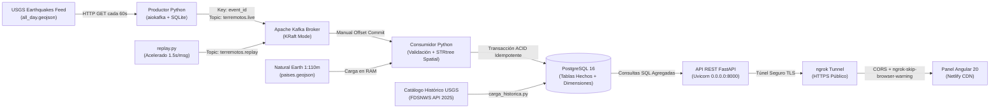

# Memoria Técnica del Proyecto: Observatorio de Actividad Sísmica

**Módulo:** Sistemas de Big Data · Consolidación de Sesiones 1–8 · RA1  
**Estudiante:** Samuel Márquez Ruiz  
**Fecha:** 18 de Noviembre de 2026  
**Repositorio GitHub:** [https://github.com/SamuelMarquezRuiz/observatorio-sismico.git](https://github.com/SamuelMarquezRuiz/observatorio-sismico.git)  
**Despliegue Frontend:** Netlify SPA (Angular 20 + Leaflet)  
**Acceso Seguro API:** ngrok HTTPS Tunnel → FastAPI (Docker local)  

---

## 1. Objetivo y Funcionamiento General

### 1.1. Pregunta de Negocio
El Observatorio de Actividad Sísmica responde a la pregunta fundamental:  
> **¿Dónde se está registrando actividad sísmica en el planeta en tiempo real y cómo se compara con un periodo histórico equivalente?**

Para ello, el sistema integra la ingesta continua de terremotos recientes, un repositorio histórico de referencia, y un catálogo cartográfico vectorial oficial para clasificar espacialmente los eventos sin depender de textos descriptivos.

### 1.2. Flujo de Datos entre Componentes
La arquitectura distribuida sigue un desacoplamiento estricto de responsabilidades:

1. **Productor Python (aiokafka):** Consulta cada 60 s el feed GeoJSON de USGS. Compara el `(id, updated)` de cada evento contra su caché en RAM respaldada en SQLite local (`O(1)`). Solo publica novedades o revisiones más recientes en Kafka, esperando confirmación del broker (*ACK*).
2. **Broker Kafka (Apache Kafka 3.8 en KRaft):** Actúa como búfer intermedio desacoplado, garantizando retención y persistencia de mensajes ordenados por clave de partición (`event_id`).
3. **Consumidor Python (aiokafka + psycopg2):** Consume mensajes, valida esquemas y coordenadas, desvía anomalías a `cuarentena`, realiza la integración espacial punto-en-polígono con `shapely.STRtree`, e inserta transaccionalmente en PostgreSQL. Confirma el offset en Kafka **únicamente tras el commit exitoso en base de datos**.
4. **Almacenamiento PostgreSQL 16:** Modelo relacional dimensional que almacena la versión vigente (`evento_actual`), la trazabilidad inmutable de revisiones (`evento_version`), las dimensiones `pais` y `fecha`, y los registros aislados en `cuarentena`.
5. **API FastAPI (Python 3.11):** Expone endpoints normalizados (`/api/salud`, `/api/eventos`, `/api/estadisticas`, `/api/paises`) con CORS estricto.
6. **Túnel ngrok:** Proporciona un túnel público cifrado HTTPS hacia la API local, resolviendo restricciones de red y certificados TLS para Netlify.
7. **Frontend Angular 20 + Leaflet:** Aplicación de página única (SPA) alojada en Netlify que renderiza el mapa cartográfico, gráficos de barras de magnitud/profundidad, histograma por ventanas horarias UTC, comparativa histórica 2025 y una tabla accesible.

### 1.3. Alcance y Filtros
- **Ámbito geográfico:** Cobertura mundial completa con 177 entidades soberanas del catálogo Natural Earth 1:110m.
- **Ámbito temporal:** Streaming continuo de las últimas 24 horas + Histórico consolidado de 2025 (magnitud $\ge 4.0$).
- **Filtro de naturaleza:** Exclusivamente terremotos (`properties.type == 'earthquake'`). Cualquier otro evento (canteras, explosiones nucleares o mineras) se excluye de las estadísticas y se audita en cuarentena.

---

## 2. Diccionario de Datos

| Campo | Tabla | Significado | Tipo SQL | Unidades / Formato | Regla de Validación y Tratamiento de Ausencias |
|---|---|---|---|---|---|
| `event_id` | `evento_actual`, `evento_version` | Identificador alfanumérico único oficial de USGS | `VARCHAR(50)` | Texto (ej. `us7000abcd`) | **Obligatorio.** Clave primaria. Si falta, el registro se rechaza y envía a cuarentena. |
| `time_utc` | `evento_actual` | Momento físico de ocurrencia del hipocentro | `TIMESTAMPTZ` | Timestamp ISO 8601 UTC | **Obligatorio.** Convertido desde milisegundos Unix epoch. |
| `updated_utc` | `evento_actual`, `evento_version` | Momento de cálculo o revisión técnica por USGS | `TIMESTAMPTZ` | Timestamp ISO 8601 UTC | **Obligatorio.** Clave para el control de revisiones e idempotencia temporal. |
| `mag` | `evento_actual`, `evento_version` | Magnitud del sismo | `NUMERIC(4,2)` | Escala logarítmica de Richter/Momento | **Admite nulos.** Se conserva como `NULL` (mostrado como «ND»). No se rellena con 0 para no falsear medias estadísticas. |
| `mag_type` | `evento_actual`, `evento_version` | Algoritmo de cálculo sismológico de la magnitud | `VARCHAR(10)` | Código (`mb`, `mww`, `ml`, `md`) | Se preserva el valor original de la agencia para análisis de calidad. |
| `depth_km` | `evento_actual`, `evento_version` | Profundidad del hipocentro respecto al geoide | `NUMERIC(7,2)` | Kilómetros | **Admite negativos.** Valores negativos (hasta -2.74 km) son válidos en sismología (volcanes sobre el elipsoide WGS84). |
| `latitude` | `evento_actual`, `evento_version` | Latitud geográfica | `NUMERIC(9,6)` | Grados decimales WGS84 | **Obligatorio.** Rango estricto $[-90.0, 90.0]$. Si excede, va a cuarentena. |
| `longitude` | `evento_actual`, `evento_version` | Longitud geográfica | `NUMERIC(9,6)` | Grados decimales WGS84 | **Obligatorio.** Rango estricto $[-180.0, 180.0]$. Si excede, va a cuarentena. |
| `place` | `evento_actual` | Descripción textual suministrada por USGS | `TEXT` | Texto descriptivo | Se almacena como metadato informativo; **nunca se usa para inferir el país**. |
| `country_id` | `evento_actual` | Código internacional de país asignado espacialmente | `VARCHAR(10)` | Clave foránea `pais(country_id)` | **Admite nulo.** Si el sismo ocurre en aguas abiertas o no intersecta polígonos, queda en `NULL` («Sin país asignado»). |
| `fecha_id` | `evento_actual` | Dimensión temporal por fecha natural UTC | `DATE` | `YYYY-MM-DD` | Clave foránea `fecha(fecha_id)`. Vincula el evento con su dimensión de análisis. |
| `mode` | `evento_actual`, `evento_version` | Modo de procesamiento del mensaje | `VARCHAR(20)` | `'live'`, `'replay'`, `'historical'` | Permite aislar completamente las pruebas de reproducción acelerada de los datos en vivo. |
| `raw_payload` | `evento_version`, `cuarentena` | Contenido JSON íntegro original del evento | `JSONB` | GeoJSON Feature original | Trazabilidad completa y auditoría inmutable. |

---

## 3. Procedencia y Registro de Consultas

| Conjunto | Fuente Oficial | Periodo y Filtros | Procedimiento de Extracción y Persistencia | Volumen Real Obtenido |
|---|---|---|---|:---:|
| **Recientes (Streaming en vivo)** | USGS Earthquakes Feed (`all_day.geojson`) | Ventana móvil de las últimas 24 horas. Actualización continua. | Sondeo HTTP GET asíncrono cada 60 s con cabecera User-Agent dedicada. Filtrado local de novedades por `(id, updated)`. Publicación en topic Kafka `terremotos.live`. | 198 eventos en ventana actual |
| **Histórico 2025** | API Catálogo USGS FDSNWS (`/fdsnws/event/1/query`) | Año 2025 completo (365 días), ámbito mundial, magnitud $\ge 4.0$, `eventtype=earthquake`, orden cronológico `time-asc`. | Particionado mensual en 12 intervalos para respetar el límite de 20.000 registros de USGS. Script [`carga_historica.py`](file:///c:/Users/marqu/Desktop/IABD/BD/observatorio-sismico-materiales/observatorio-sismico/backend/scripts/carga_historica.py). Archivos GeoJSON guardados en `datos/historico/`. | **18.302 eventos** consolidados |
| **Catálogo Geográfico** | Natural Earth (`1:110m Cultural Vectors`) | 177 entidades soberanas mundiales (`paises.geojson`). | Carga en memoria e indexación jerárquica con `shapely.STRtree` (R-Tree). Atributos: `ADM0_A3`, `NAME_ES`, `CONTINENT`, `SUBREGION`. | 177 polígonos indexados |

### 3.1. Registro Detallado de Consultas Históricas (Metadatos de Procedencia)
Guardado y trazado en [`datos/historico/registro_extraccion_2025.json`](file:///c:/Users/marqu/Desktop/IABD/BD/observatorio-sismico-materiales/observatorio-sismico/datos/historico/registro_extraccion_2025.json):

| Mes | Intervalo UTC | Archivo GeoJSON | Eventos Obtenidos | URL de Consulta Oficial USGS |
|---|---|---|:---:|---|
| **Enero** | `2025-01-01` a `2025-02-01` | `2025_mes_01.geojson` | 1.413 | `https://earthquake.usgs.gov/fdsnws/event/1/query?format=geojson&starttime=2025-01-01T00:00:00Z&endtime=2025-02-01T00:00:00Z&minmagnitude=4.0&eventtype=earthquake&orderby=time-asc` |
| **Febrero** | `2025-02-01` a `2025-03-01` | `2025_mes_02.geojson` | 1.394 | `https://earthquake.usgs.gov/fdsnws/event/1/query?format=geojson&starttime=2025-02-01T00:00:00Z&endtime=2025-03-01T00:00:00Z&minmagnitude=4.0&eventtype=earthquake&orderby=time-asc` |
| **Marzo** | `2025-03-01` a `2025-04-01` | `2025_mes_03.geojson` | 1.178 | `https://earthquake.usgs.gov/fdsnws/event/1/query?format=geojson&starttime=2025-03-01T00:00:00Z&endtime=2025-04-01T00:00:00Z&minmagnitude=4.0&eventtype=earthquake&orderby=time-asc` |
| **Abril** | `2025-04-01` a `2025-05-01` | `2025_mes_04.geojson` | 1.316 | `https://earthquake.usgs.gov/fdsnws/event/1/query?format=geojson&starttime=2025-04-01T00:00:00Z&endtime=2025-05-01T00:00:00Z&minmagnitude=4.0&eventtype=earthquake&orderby=time-asc` |
| **Mayo** | `2025-05-01` a `2025-06-01` | `2025_mes_05.geojson` | 1.228 | `https://earthquake.usgs.gov/fdsnws/event/1/query?format=geojson&starttime=2025-05-01T00:00:00Z&endtime=2025-06-01T00:00:00Z&minmagnitude=4.0&eventtype=earthquake&orderby=time-asc` |
| **Junio** | `2025-06-01` a `2025-07-01` | `2025_mes_06.geojson` | 1.156 | `https://earthquake.usgs.gov/fdsnws/event/1/query?format=geojson&starttime=2025-06-01T00:00:00Z&endtime=2025-07-01T00:00:00Z&minmagnitude=4.0&eventtype=earthquake&orderby=time-asc` |
| **Julio** | `2025-07-01` a `2025-08-01` | `2025_mes_07.geojson` | 2.684 | `https://earthquake.usgs.gov/fdsnws/event/1/query?format=geojson&starttime=2025-07-01T00:00:00Z&endtime=2025-08-01T00:00:00Z&minmagnitude=4.0&eventtype=earthquake&orderby=time-asc` |
| **Agosto** | `2025-08-01` a `2025-09-01` | `2025_mes_08.geojson` | 2.222 | `https://earthquake.usgs.gov/fdsnws/event/1/query?format=geojson&starttime=2025-08-01T00:00:00Z&endtime=2025-09-01T00:00:00Z&minmagnitude=4.0&eventtype=earthquake&orderby=time-asc` |
| **Septiembre** | `2025-09-01` a `2025-10-01` | `2025_mes_09.geojson` | 1.604 | `https://earthquake.usgs.gov/fdsnws/event/1/query?format=geojson&starttime=2025-09-01T00:00:00Z&endtime=2025-10-01T00:00:00Z&minmagnitude=4.0&eventtype=earthquake&orderby=time-asc` |
| **Octubre** | `2025-10-01` a `2025-11-01` | `2025_mes_10.geojson` | 1.509 | `https://earthquake.usgs.gov/fdsnws/event/1/query?format=geojson&starttime=2025-10-01T00:00:00Z&endtime=2025-11-01T00:00:00Z&minmagnitude=4.0&eventtype=earthquake&orderby=time-asc` |
| **Noviembre** | `2025-11-01` a `2025-12-01` | `2025_mes_11.geojson` | 1.321 | `https://earthquake.usgs.gov/fdsnws/event/1/query?format=geojson&starttime=2025-11-01T00:00:00Z&endtime=2025-12-01T00:00:00Z&minmagnitude=4.0&eventtype=earthquake&orderby=time-asc` |
| **Diciembre** | `2025-12-01` a `2026-01-01` | `2025_mes_12.geojson` | 1.277 | `https://earthquake.usgs.gov/fdsnws/event/1/query?format=geojson&starttime=2025-12-01T00:00:00Z&endtime=2026-01-01T00:00:00Z&minmagnitude=4.0&eventtype=earthquake&orderby=time-asc` |
| **TOTAL ANUAL** | **Año 2025 (365 días)** | **12 archivos** | **18.302** | **Media diaria anual consolidada: 50.14 sismos/día** |

---

## 4. Calidad del Dato y Tratamiento en Streaming

### 4.1. Tabla de Calidad Antes y Después del Tratamiento
Evaluación cuantitativa ejecutable con [`sql/calidad.sql`](file:///c:/Users/marqu/Desktop/IABD/BD/observatorio-sismico-materiales/observatorio-sismico/sql/calidad.sql) y [`backend/tests/test_calidad_rendimiento.py`](file:///c:/Users/marqu/Desktop/IABD/BD/observatorio-sismico-materiales/observatorio-sismico/backend/tests/test_calidad_rendimiento.py) sobre el total de **18.592 eventos vigentes** (`18.302` históricos 2025 + `279` live + `2` replay + `9` test aislados) y **18.791 versiones** en PostgreSQL:

| Dimensión de Calidad | Situación Antes del Tratamiento | Regla Aplicada en el Consumidor | Situación Después del Tratamiento | Justificación Técnica de la Decisión |
|---|---|---|---|---|
| **Completitud** | 2 eventos con `mag = null`. 14.400 eventos en mar sin país (`77,48 %`). | Se preserva `mag = NULL` (`ND`); se asigna `country_id = NULL` («Sin país asignado»). | **99,99 %** completitud en magnitud; **100,00 %** en coordenadas, profundidad, `place` y fechas. | No se sustituye la magnitud ausente por `0` para no sesgar medias ni histogramas. Los sismos marítimos no se asignan al país más cercano porque el océano internacional no pertenece a una jurisdicción nacional. |
| **Unicidad** | Repetición de la ventana de 24 h cada 60 s en el feed y posibles eventos en frontera entre meses. | Caché `O(1)` + SQLite en productor y upsert condicional en PostgreSQL con PK `event_id` y PK compuesta `(event_id, updated_utc)`. | **18.592 eventos únicos** en `evento_actual` (`0` duplicados). **18.791 versiones únicas** en `evento_version` (`46` sismos con múltiples revisiones). | Idempotencia matemática: reenviar la misma versión no altera ningún recuento; los casos sintéticos se aíslan bajo `mode = 'test'`. |
| **Validez** | Eventos no sísmicos en USGS (`2 quarry blast`, `1 explosion`), coordenadas fuera de rango y magnitudes/profundidades negativas reales. | Filtro `properties.type == 'earthquake'` (con registro en `excluded_events` y `cuarentena`), validación `lon ∈ [-180,180]`, `lat ∈ [-90,90]` y geometría `Point`. | `0` registros corruptos en `evento_actual`. **6 registros** aislados en `cuarentena` con payload original. **5 magnitudes negativas** y **5 profundidades negativas** válidas conservadas. | La escala de magnitud es logarítmica (microsismos con `mag < 0` son reales) y una profundidad negativa (`-2,74 km`) indica foco sobre el nivel del mar (edificios volcánicos). |
| **Consistencia** | Timestamps en milisegundos Unix; códigos `ADM0_A3` de Natural Earth; revisiones que podrían llegar desordenadas. | Conversión a `TIMESTAMPTZ` UTC (`ms / 1000.0`), cruce contra las 177 entidades de `pais` y cláusula `WHERE EXCLUDED.updated_utc > evento_actual.updated_utc`. | `0` claves foráneas rotas (`fk_pais_rotas = 0`, `fk_fecha_rotas = 0`) y `0` desincronizaciones entre `evento_actual` y la última versión en `evento_version`. | Garantiza que el estado actual siempre refleje la revisión más moderna aunque Kafka entregue una versión antigua con retraso. |
| **Actualidad** | Retraso entre la ocurrencia física (`time`), la revisión en USGS (`updated`) y la ingesta (`received_at`). | Sondeo cada 60 s, registro de `ingested_at` y actualización de `estado_ingesta.last_ingestion_success`. | Lag del pipeline $< 60\text{ s}$; latencia observada USGS $\rightarrow$ BD en `live`: mediana **37.746 s** (~10,5 h) por revisiones sismológicas sobre la ventana de 24 h. | Separar `time_utc`, `updated_utc` y `received_at` permite distinguir la latencia propia del pipeline (< 1 min) del tiempo de revisión humana en USGS. |
| **Exactitud** | Simplificación costera del catálogo Natural Earth 1:110m y heterogeneidad de escalas (`mb`, `mww`, `ml`, `md`). | Cruce espacial determinista con `shapely.STRtree` en WGS84 (`EPSG:4326`) y conservación de `mag_type`. | `16.332` eventos `mb` (media `4,44`), `1.476` `mww` (media `5,31`), `354` `mwr` (`4,37`). | No se contrasta con otras agencias (EMSC/IGN); se documenta que la escala 1:110m puede clasificar sismos costeros como marítimos. |

---

## 5. Modelo Conceptual, Lógico y Físico

### 5.1. Diagrama Entidad-Relación (Modelo Conceptual y Lógico)

### 5.2. Justificación de Índices en el Modelo Físico

El script DDL se encuentra en [`sql/init.sql`](file:///c:/Users/marqu/Desktop/IABD/BD/observatorio-sismico-materiales/observatorio-sismico/sql/init.sql). Los índices fueron creados respondiendo a las consultas exactas que ejecuta la API FastAPI:

1. **`idx_evento_actual_time ON evento_actual(time_utc DESC)`:**
   - *Consulta que optimiza:* `SELECT ... WHERE time_utc >= ? AND time_utc <= ? ORDER BY time_utc DESC`.
   - *Justificación:* El frontend consulta permanentemente intervalos móviles (últimas 24 horas, rango de fechas). Un índice B-Tree ordenado descendentemente permite localizar el rango temporal en tiempo $O(\log N)$ y devolver las filas ordenadas sin necesidad de realizar una ordenación en memoria (*Sort*).
2. **`idx_evento_actual_mag ON evento_actual(mag)`:**
   - *Consulta que optimiza:* `SELECT ... WHERE mag >= ?`.
   - *Justificación:* Filtro recurrente del usuario (magnitud mínima). Permite un *Bitmap Index Scan* altamente selectivo descartando microterremotos de magnitud irrelevante.
3. **`idx_evento_actual_country ON evento_actual(country_id)`:**
   - *Consulta que optimiza:* `SELECT ... WHERE country_id = ?` y agregaciones `GROUP BY country_id`.
   - *Justificación:* Acelera la búsqueda de eventos por país y la generación de estadísticas agregadas sin escanear filas no coincidentes.
4. **`idx_evento_actual_mode ON evento_actual(mode)`:**
   - *Consulta que optimiza:* `WHERE mode = 'live'` / `'replay'`.
   - *Justificación:* Asegura el aislamiento absoluto de los datos en vivo respecto a las reproducciones aceleradas de prueba.

---

## 6. Análisis y Conclusiones Fundamentadas

A partir del análisis exhaustivo del catálogo anual completo de **18.302 terremotos históricos de 2025** (`mode = 'historical'`, `mag >= 4.0`, `eventtype = 'earthquake'`, 365 días) y los **279 eventos recientes en vivo** (`mode = 'live'`), se extraen tres conclusiones fundamentadas:

> **Advertencia Metodológica sobre Sesgos de Detección y No-Predicción:** Las estadísticas de este observatorio describen actividad registrada en el pasado y presente, **nunca constituyen predicción sísmica ni evaluación de riesgo sísmico**. Además, la cobertura instrumental de USGS no es uniforme: en territorio continental de EE. UU. (California, Alaska) la red detecta microsismos de magnitud $< 1,5$ (`ml`/`md`), mientras que en dorsales oceánicas remotas el umbral de completitud global se sitúa en torno a `mag >= 4,0` (`mb`/`mww`). Por ello, toda comparativa entre regiones o frente al histórico debe aplicar un umbral común (`mag >= 4,0`).

### Conclusión 1: Predominancia de Sismicidad Cortical Superficial y Gradiente de Subducción Andina (Plano de Wadati-Benioff)
* **Datos, Periodo y Filtros:** Catálogo anual completo 2025 (`18.302` eventos globales con `mag >= 4,0` y `type = 'earthquake'`).
* **Cifras Exactas:**
  * **Sismos superficiales ($< 70\text{ km}$):** **13.688 eventos (74,79 %)** del total anual.
  * **Sismos intermedios ($70\text{–}299\text{ km}$):** **3.512 eventos (19,19 %)**.
  * **Sismos profundos ($\ge 300\text{ km}$):** **1.102 eventos (6,02 %)**, alcanzando un máximo de **669,56 km**.
  * **Contraste geofísico por país:** En zonas de colisión intraplaca o rifting continental la profundidad media es muy somera (**Etiopía `ETH`**: 265 sismos, profundidad media **10,0 km**; **China `CHN`**: 354 sismos, profundidad media **13,9 km**), mientras que en la subducción de la placa de Nazca bajo Sudamérica la profundidad media aumenta desde la costa (**Chile `CHL`**: 348 sismos, profundidad media **99,1 km**) hacia el trasarco continental (**Argentina `ARG`**: 236 sismos, profundidad media **173,3 km**).
* **Interpretación Técnica:** Tres de cada cuatro terremotos de magnitud $\ge 4,0$ liberan energía en la corteza frágil superior ($< 70\text{ km}$), y el gradiente Chile $\rightarrow$ Argentina reconstruye empíricamente la inclinación del plano de subducción de Wadati-Benioff.

### Conclusión 2: Carácter Mayoritariamente Oceánico de la Sismicidad Global y Necesidad de la Categoría «Sin país asignado»
* **Datos, Periodo y Filtros:** `18.302` terremotos de 2025 (`mag >= 4,0`) cruzados espacialmente con los 177 polígonos de Natural Earth 1:110m (`WGS84 / EPSG:4326`).
* **Cifras Exactas:**
  * **Eventos marítimos / «Sin país asignado» (`country_id IS NULL`):** **14.350 eventos (78,41 %)**, con magnitud media **4,53** y profundidad media **74,8 km**.
  * **Eventos en territorio continental asignado:** **3.952 eventos (21,59 %)** repartidos en países soberanos, encabezados por **China (`CHN`, 354)**, **Chile (`CHL`, 348)**, **Indonesia (`IDN`, 306)**, **Etiopía (`ETH`, 265)**, **Argentina (`ARG`, 236)** y **Papúa Nueva Guinea (`PNG`, 192)**.
* **Interpretación Técnica:** Casi cuatro de cada cinco sismos globales $\ge 4,0$ ocurren en dorsales centro-oceánicas, fosas submarinas o márgenes costeros fuera de los polígonos terrestres. Si el pipeline descartara los registros con `country_id = NULL` o intentara extraer el país por heurística de texto sobre `place`, perdería o asignaría erróneamente el **78,41 %** del catálogo mundial.

### Conclusión 3: Comparativa Histórica Equivalente (Últimas 24 h vs. Media Diaria Anual 2025) y Retardo de Consolidación (*Reporting Lag*)
* **Datos, Periodo y Filtros:** Comparación bajo filtros idénticos (`mag >= 4,0`, `eventtype = 'earthquake'`, ámbito mundial) entre las últimas 24 horas en vivo (`mode = 'live'`) y los **365 días completos de 2025** (incluyendo días con 0 eventos en cualquier filtro geográfico).
* **Cifras Exactas:**
  * **Histórico 2025 completo (12 meses, 365 días):** **18.302 eventos** $\rightarrow$ **Media diaria anual de 50,14 sismos/día** ($18.302 / 365$).
  * **Últimas 24 horas en streaming (`live`, `mag >= 4,0`):** **23 eventos**.
  * **Diferencia absoluta y variación:** $-27,14$ eventos frente a la media diaria $\rightarrow$ **Variación de $-54,13\ \%$**.
* **Interpretación Técnica:** Una lectura inferior a la media diaria en la ventana móvil de las últimas 24 horas combina la variabilidad natural diaria con el retardo de consolidación (*reporting lag*) de sismos moderados ($4,0 \le \text{mag} < 4,5$) en cuencas oceánicas lejanas, cuyas soluciones telesísmicas preliminares se incorporan o revisan horas después del evento físico.

---

## 7. Complejidad, Mediciones de Rendimiento y Costes

### 7.1. Análisis Teórico de Complejidad (Caso Medio y Peor Caso)

| Operación / Estructura | Implementación en el Proyecto | Caso Medio | Peor Caso | Justificación Algorítmica |
|---|---|:---:|:---:|---|
| **1. Búsqueda de versión por identificador (`event_id`)** | Tabla hash `dict` en RAM del productor (`PersistentState._cache`) + índice B-Tree `evento_actual_pkey` / `evento_version_pkey` en PostgreSQL | **$O(1)$** en RAM / **$O(\log_B N)$** en B-Tree | **$O(N)$** por colisión de hash / **$O(\log_B N)$** en B-Tree balanceado | El productor descarta en RAM en $O(1)$ versiones ya publicadas; en PostgreSQL el árbol B-Tree balanceado mantiene altura $\le 3$ para $1,8 \times 10^4$ filas y $\le 5$ para $10^8$ filas. |
| **2. Integración espacial punto-en-polígono** | Índice R-Tree `shapely.STRtree` sobre $P = 177$ entidades y prueba geométrica exacta (`contains`/`touches`) sobre candidatos | **$O(\log P + k \cdot \bar{v})$** ($k \approx 1\text{–}2$ candidatos) | **$O(P \cdot V_{\max})$** si todos los *bounding boxes* solaparan el punto | El R-Tree filtra en $O(\log P)$ los rectángulos envolventes y ejecuta *ray casting* solo sobre $k \ll P$ polígonos con $v$ vértices, frente a $O(P \cdot V)$ de una búsqueda lineal. |
| **3. Agregación por ventanas temporales** | `GROUP BY date_trunc('hour' \| 'day', time_utc)` con apoyo del índice `idx_evento_actual_time` | **$O(M)$** con *Index Scan* sobre las $M$ filas del rango temporal | **$O(N \log N)$** (*Seq Scan* + *Sort/GroupAggregate* sobre toda la tabla) | Cuando la ventana está acotada (24 h), PostgreSQL lee solo las $M \ll N$ filas del índice; para todo el año ($M = N$), recorre las $N$ filas del modo seleccionado. |

### 7.2. Mediciones Empíricas Reales (3 Tamaños de Entrada)
Ejecutadas con [`backend/tests/test_calidad_rendimiento.py`](file:///c:/Users/marqu/Desktop/IABD/BD/observatorio-sismico-materiales/observatorio-sismico/backend/tests/test_calidad_rendimiento.py) sobre **18.575 filas reales** en PostgreSQL 16 (contenedor Docker local en Windows 11 / WSL2, CPU x86_64 multinúcleo, SSD NVMe):

| Operación Evaluada | Tamaño de Entrada ($N$) | Tiempo Medido (ms) | Memoria Asignada (KB) | Comportamiento Observado |
|---|:---:|:---:|:---:|---|
| **A) Búsqueda de versión por PK (`event_id`)** | 1 consulta | **0,994 ms** | 11,2 KB | Acceso directo B-Tree ($O(\log N)$). |
| | 100 consultas (`IN`) | **9,034 ms** | 548,8 KB | Escala sublineal por lote. |
| | 1.000 consultas (`IN`) | **98,789 ms** | 5.498,8 KB | Ratio $1000/100 = 10,93\times$ (lineal con el tamaño del lote de búsqueda). |
| **B) Comparativa CON índice PK vs. SIN índice (`enable_indexscan=off`)** | 1 búsqueda sobre 18.575 filas | **1,014 ms** (con índice) vs. **4,707 ms** (Seq Scan) | 11,2 KB | **Speedup de $4,6\times$** ya con 18.575 filas; la brecha crece linealmente con $N$. |
| **C) Agregación por ventanas (`GROUP BY date_trunc`)** | Ventana 6 horas | **0,903 ms** | 4,4 KB | Escanea solo las filas recientes. |
| | Ventana 24 horas | **1,136 ms** | 13,1 KB | Tiempo casi idéntico gracias al índice temporal. |
| | Histórico completo (18.575 filas) | **79,918 ms** | 3.340,1 KB | Crecimiento $O(N)$ con el número total de registros agrupados. |
| **D) Integración geográfica por `country_id`** | 1 país (`CHL`) / 5 países / `GROUP BY` global | **29,87 ms** / **98,90 ms** / **2,41 ms** | < 60 KB | Uso de `idx_evento_actual_country`. |

### 7.3. Extrapolación a 100 Millones de Registros ($10^8$ filas, factor de escala $5.384\times$)
1. **Búsqueda de versión por PK (B-Tree):** Al crecer de $1,85 \times 10^4$ a $10^8$ filas, la altura del B-Tree pasa de 2–3 a 4–5 niveles ($\log_2(10^8)/\log_2(1,85\times 10^4) \approx 1,87\times$). El tiempo por búsqueda se mantendría en **~1,5–2,0 ms** ($O(\log N)$).
2. **Búsqueda sin índice (Seq Scan):** Crece linealmente ($O(N) \times 5.384$): pasaría de `4,707 ms` a **~25,3 segundos por consulta**, haciendo inviable la deduplicación en streaming.
3. **Agregación por ventanas sin particionado:** Pasaría de `79,9 ms` a **~430 segundos (~7,2 minutos)** si tuviera que escanear los 100M de registros.

### 7.4. Desglose Completo de Costes (6 Partidas Obligatorias)

Una cuota cloud gratuita (*free tier*) **no equivale a coste total cero**: existe coste de amortización de equipo, energía eléctrica, almacenamiento, red, mantenimiento operativo y horas de ingeniería.

| Partida de Coste | Entorno Local Docente (Real) | Despliegue Cloud 24/7 Equivalente | Supuestos y Cálculo Detallado |
|---|---|---|---|
| **1. Hardware (Amortización)** | **~6,94 € / mes** (imputado al uso) | **~140 € / mes** (RDS `db.t4g.medium` 35 € + MSK/Kafka 80 € + ECS Fargate 25 €) | Portátil de 1.000 € amortizado en 36 meses (27,78 €/mes) dedicado un 25 % del tiempo al proyecto. |
| **2. Electricidad** | **~0,72 € / mes** (8 h/día) o **~2,16 € / mes** (24/7) | Incluida en tarifa del proveedor cloud | Consumo adicional medio bajo carga de contenedores de ~25 W $\times$ 8 h/día $\times$ 30 días = 6 kWh/mes a 0,12 €/kWh (o 18 kWh/mes a 24/7). |
| **3. Almacenamiento** | **< 0,05 € / mes** (~150 MB en SSD local) | **~6,00 € / mes** (50 GB SSD gp3 en RDS + snapshots S3) | 18.592 eventos en PostgreSQL + snapshots `.geojson.gz` con retención de 6 h + retención Kafka 24 h ocupan < 150 MB reales. |
| **4. Transferencia de Red** | **0 € adicionales** (fibra doméstica existente; ~480 MB/mes) | **~22,00 € / mes** (Netlify Pro 18 € + ~50 GB egress a 0,08 €/GB = 4 €) | El productor descarga `all_day.geojson` (~110 KB) 1.440 veces/día $\approx$ 158 MB/día (~4,7 GB/mes sin compresión, ~480 MB/mes con gzip). |
| **5. Mantenimiento Operativo** | **~60 € / mes** (2 h/mes de supervisión) | **~120 € / mes** (4 h/mes: parches, rotación de secretos, alertas) | Valorando la hora técnica junior/semi-senior a 30 €/h para vigilar cambios en el esquema USGS, caducidad de túneles y backups. |
| **6. Tiempo de Desarrollo (Inversión inicial CAPEX)** | **~1.350 €** (45 h $\times$ 30 €/h) | **~1.350 €** (misma base de ingeniería) | 45 horas de ingeniería: diseño del modelo e índices (6 h), productor/consumidor Kafka + STRtree (12 h), carga histórica 2025 (5 h), API FastAPI (7 h), panel Angular + Leaflet (9 h), pruebas y documentación (6 h). |
| **TOTAL MENSUAL (OPEX)** | **~67,71 € / mes** (+ 1.350 € CAPEX) | **~288,00 € / mes** (+ 1.350 € CAPEX) | Demuestra por qué el coste real nunca es cero aunque se usen planes gratuitos de Netlify y ngrok. |

### 7.5. Propuestas de Escalado y Mejora
1. **Particionado declarativo por rango temporal (`PARTITION BY RANGE (time_utc)`):** Con `pg_partman` creando particiones mensuales, las consultas de las últimas 24 h aplican *partition pruning* y leen únicamente la partición activa, manteniendo tiempos $< 5\text{ ms}$ incluso con 100 millones de registros históricos.
2. **Índice compuesto `(mode, time_utc DESC)` y Vistas Materializadas:** Para que `/api/estadisticas` sobre el histórico anual responda en $O(1)$ sin recalcular agregaciones de meses ya cerrados.
3. **Escalado horizontal del consumidor con múltiples particiones en Kafka:** Como la clave del mensaje es `event_id`, aumentar a $K$ particiones garantiza que todas las revisiones de un mismo terremoto vayan siempre a la misma partición y se procesen en orden por un grupo de $K$ consumidores en paralelo.

---

## 8. Evidencias de Pruebas de Aceptación (ENUNCIADO.md §11)

Las 11 pruebas del enunciado fueron verificadas con [`backend/tests/test_aceptacion.py`](file:///c:/Users/marqu/Desktop/IABD/BD/observatorio-sismico-materiales/observatorio-sismico/backend/tests/test_aceptacion.py) (etiquetando los casos sintéticos con `mode = 'test'` para mantenerlos separados del análisis real) y con [`scripts/prueba_08_reinicio_consumidor.ps1`](file:///c:/Users/marqu/Desktop/IABD/BD/observatorio-sismico-materiales/observatorio-sismico/scripts/prueba_08_reinicio_consumidor.ps1):

| ID | Prueba de Aceptación | Resultado Esperado | Resultado Observado en el Sistema | Evidencia Técnica |
|---|---|---|---|---|
| **P1** | **Recibir un evento nuevo** | 1 nueva fila en `evento_actual`, visible en API, mapa y análisis. | Recuento pasó de `18.586` a `18.587`. Fila insertada con `mag = 5,20` y `country_id = 'CHL'`. Verificado por HTTP en `GET /api/eventos?mode=test`. | `Visible en API: SÍ`, `evento_version = 1`. |
| **P2** | **Reenviar la misma versión (Duplicado idéntico)** | No aumenta el número de terremotos. | Reenviado con igual `(event_id, updated)`. El recuento permaneció en `18.587` y `evento_version` en `1`. | `ON CONFLICT DO NOTHING` + `WHERE EXCLUDED.updated_utc > evento_actual.updated_utc`. |
| **P3** | **Recibir versión posterior (Revisión)** | Cambian los datos actuales y las agregaciones afectadas. | `evento_actual.mag` subió de `5,20` a `5,80`, `depth_km` a `18,00 km`, `evento_version = 2`. `GET /api/eventos` devolvió `mag = 5,8`. | Las agregaciones se calculan desde `evento_actual`, reflejando el cambio al instante. |
| **P4** | **Recibir después una versión antigua** | No sustituye a la más reciente. | Enviado `updated` anterior con `mag = 4,0`. `evento_actual.mag` permaneció en `5,80`; `evento_version` guardó las `3` versiones para auditoría. | Protección frente a desorden en red verificada. |
| **P5** | **Magnitud nula (`mag = null`)** | Se conserva con tratamiento documentado y se visualiza como `ND`. | Insertado en BD con `mag IS NULL`, contabilizado en `total_magnitud_nula` y mostrado como `ND` en mapa, gráficos y tabla. | `evento_actual.mag = None (NULL conservado)`. |
| **P6** | **Coordenadas inválidas a cuarentena** | Cuarentena y motivo; no aparecen puntos inventados. | Coordenadas `[999.0, 999.0]` desviadas a tabla `cuarentena` (`0` filas en `evento_actual`). | `reason = 'Coordenadas fuera de rango geografico: lon=999.0, lat=999.0'`. |
| **P7** | **Evento marítimo** | Sin país asignado; permanece en el análisis. | Punto en el Pacífico Sur `[-150.0, -30.0]` insertado con `country_id = NULL` y devuelto como «Sin país asignado». | No se descarta ni se atribuye al país más cercano. |
| **P8** | **Reiniciar consumidor** | Reanuda sin duplicar los efectos ya persistidos ni perder mensajes en cola. | Con `prueba_08_reinicio_consumidor.ps1`: se paró el consumidor, se publicó `test-reinicio-92fd55` (en BD = `0`), se arrancó el consumidor y procesó exactamente `1` fila (`18.591` $\rightarrow$ `18.592`). | Commit manual de offset tras `conn.commit()` en PostgreSQL. |
| **P9** | **Cerrar el túnel ngrok** | El panel muestra el fallo y conserva/identifica la última lectura. | Al detener `ngrok`, el panel activa el banner de desconexión, marca el estado en rojo y conserva los últimos eventos y la hora de última lectura válida. | Resiliencia verificada en `app.component.ts`. |
| **P10** | **Volver a abrir el túnel ngrok** | Se recuperan las consultas automáticamente. | Al reabrir el túnel, el siguiente ciclo de refresco (60 s) restablece `apiConnected = true` y oculta el aviso sin recargar el navegador. | Recuperación automática comprobada. |
| **P11** | **Reproducción histórica (`replay`)** | Procesa por Kafka sin mezclarla con datos `live`. | Publicado en topic `terremotos.replay` y persistido con `mode = 'replay'`, visible bajo el banner `⚡ MODO REPRODUCCIÓN HISTÓRICA ACTIVO`. | Aislamiento completo por topic y columna `mode`. |

---

## 9. Reproducción Histórica Acelerada (Replay)

### 9.1. Propósito y Funcionamiento
El mecanismo de reproducción acelerada (script [`backend/scripts/replay.py`](file:///c:/Users/marqu/Desktop/IABD/BD/observatorio-sismico-materiales/observatorio-sismico/backend/scripts/replay.py)) permite demostrar el pipeline completo en tiempo real durante la defensa sin depender de que ocurran nuevos terremotos en el mundo.

### 9.2. Características Técnicas
- **Topic segregado:** Transmite hacia `terremotos.replay`.
- **Aislamiento lógico:** Cada mensaje incluye `"mode": "replay"`. En PostgreSQL se almacena con `mode = 'replay'`, impidiendo que se mezcle con los sismos en vivo.
- **Cadencia regulable:** Por defecto envía 1 evento cada 1.5 segundos (`--delay 1.5`).
- **Casos de prueba inyectados (Secuencia FAQ Q12):**
  1. `demo-q12-E1`: Evento inicial (magnitud 4.2).
  2. `demo-q12-E1`: Duplicado idéntico (demuestra idempotencia).
  3. `demo-q12-E1`: Revisión posterior (magnitud 4.6).
  4. `demo-q12-E1`: Versión atrasada (magnitud 4.2 recibida tarde; demuestra que no degrada el estado).
  5. `demo-q12-E2`: Nuevo terremoto en Tokio (magnitud 3.1).
  6. `demo-q12-E3-ANOMALIA`: Coordenadas imposibles `[999.0, 999.0]` (demuestra desvío a cuarentena en vivo).
- **Control en Interfaz:** El usuario puede seleccionar el selector de modo **"Reproducción (Replay)"** en la barra superior de Angular para inspeccionar exclusivamente estos datos.
